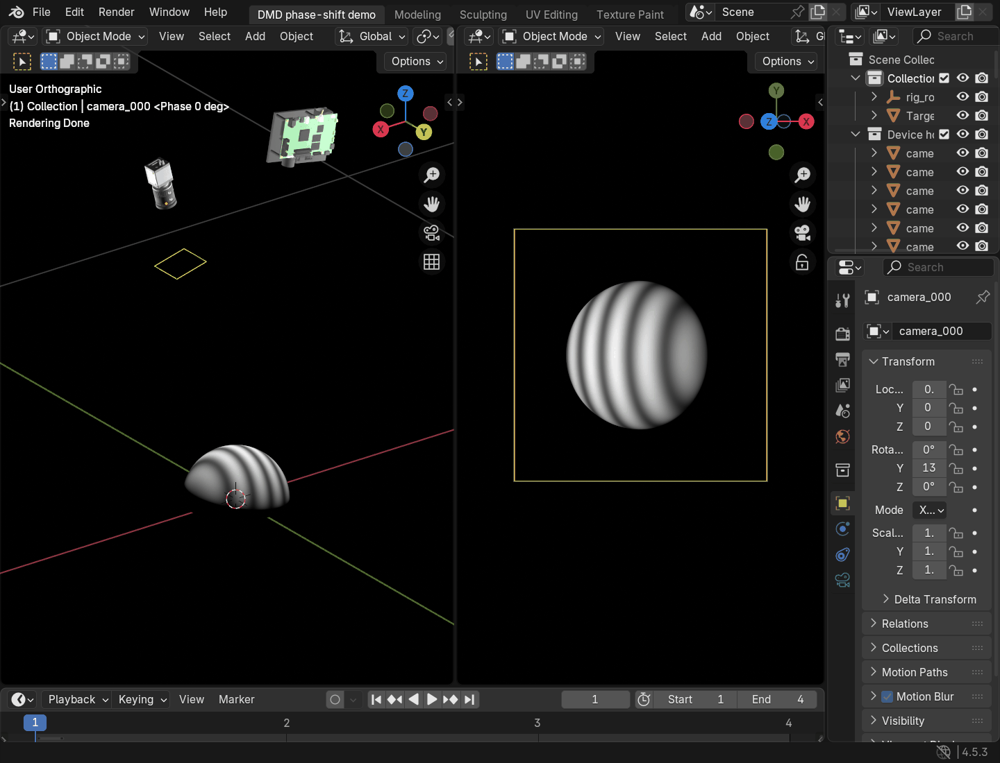

# DMD Structured-Light Simulator

The shared projector forward model defaults to a continuous Gaussian PSF with sigma=1 source/carrier pixel and 32 numerical samples per pixel. Configure `render.projector_psf`; use `sigma_px: 0` for a sharp control. The PSF acts before projector Emission and surface reflection. Camera blur remains independent. Both batch captures and packed interactive phase sequences use this model. See [the shared configuration](PROJECTOR_PSF.md).

[简体中文](README.md) | **English**

A Blender/Cycles structured-light simulator with one camera and one projector,
supporting **orthogonal DMD** and **Diamond-DMD with configurable row and column counts**.

Projector modeling and texture projection use the
**[Projectors](https://github.com/Ocupe/Projectors)** Blender add-on by **Jonas Schell**
(GPL-3.0-or-later). This project builds on it to provide both DMD adaptations,
fringe-sequence simulation and calibration ground-truth export. An adapted copy
is bundled and loaded automatically by the scripts; no separate add-on installation
is required. See [UPSTREAM.md](3rdparty/Projectors/UPSTREAM.md) for local changes and
[THIRD_PARTY_NOTICES.md](THIRD_PARTY_NOTICES.md) for copyright and license details.

## Blender UI and four-step phase shifting



The animation captures a running Blender window: the left viewport shows the
camera, projector and sphere, and the right shows the camera view. Timeline frames
1–4 select phases of 0°, 90°, 180° and 270°. The UI recording loads local
manufacturer CAD models (me2p_v1226 camera and LightCrafter4500 projector).
Those CAD source files are not distributed here; the default examples use the
bundled lightweight housings.

The sphere radius is 0.1 m and the fringe period is 48 logical pixels. Both DMD
examples use the same sphere and four-step sequence. The [camera-output GIF](assets/preview.gif)
preserves the grayscale values of the four 512×512 renders; the Blender viewport
uses the Standard display transform for interactive viewing.

## Installation and quick start

Validated on Linux with Python 3.10 and Blender 4.5.3. Install Blender, then run:

```bash
git clone https://github.com/dspangpang/dmd-structured-light-sim.git
cd dmd-structured-light-sim
python3 -m venv .venv
source .venv/bin/activate
python -m pip install -r requirements.txt
export BLENDER_BIN=/path/to/blender

# Orthogonal DMD
python scripts/run_simulation.py --config examples/orthogonal/scene.json --output output/orthogonal

# Diamond-DMD
python scripts/run_simulation.py --config examples/diamond/scene.json --output output/diamond
```

The examples load the bundled models, generate fringes and render on the CPU.
Choose a new output directory for each run.

Open an interactive scene:

```bash
python scripts/run_simulation.py --config examples/orthogonal/scene.json --output output/interactive --interactive
```

Select frames 1–4 on the Blender timeline to change phase, or press Space to play.
Drag with the middle mouse button in the left viewport to orbit the setup; the
right viewport retains the camera view. The scene is saved as
`output/interactive/scene.blend`, with all four fringe images packed for reopening.
Use `examples/diamond/scene.json` to view the Diamond-DMD example.

## Configuration and models

Copy either example's `scene.json` to change device poses, focal lengths,
resolutions, patterns, targets and materials. `patterns.period_px` sets the fringe
period; `phase_steps` sets the number of phase shifts. Custom grayscale images
follow the explicit order in `patterns.files`. Positions are in metres, focal
lengths in millimetres, pixel pitches in micrometres, and sizes in `[width, height]`.

| DMD type | Logical input | Simulation texture |
|---|---|---|
| `orthogonal` | Configurable width and height | Same as the input |
| `diamond` | Configurable width and height, including odd counts | Automatically sized carrier for the 45° staggered array with a matching projector rotation |

The Diamond example defaults to `projector.resolution: [640, 480]`. Set these
two integers to configure another size; each must be at least 2. Examples include
`[641, 481]`, `[1280, 800]` and the DLP4500 size `[912, 1140]`. Custom fringe images
must match the configured size. Carrier dimensions, coordinate mappings and
exported projector intrinsics update automatically.

The Diamond carrier size is not the hardware upload size. Exported projector
intrinsics refer to carrier coordinates; conversions are recorded in the run's
`inputs/dmd_mapping.json`. The model describes geometric projection and texture imaging.

`assets/models/` contains three OBJ models with dimensions in metres:

- `camera.obj` and `projector.obj`: lightweight schematic housings loaded through
  `visualization`; optical parameters are determined by the configuration.
- `sphere.obj`: a sphere of radius 0.1 m, centred at the origin, loaded through `target.asset`.

These original example models are generated by the project. Run
`scripts/generate_assets.py` in Blender to rebuild them. Keep material files beside
their OBJ files. All installation and testing dependencies use one `requirements.txt`.
To use your own device CAD, point `visualization.camera_model.path` and
`visualization.projector_model.path` to local OBJ files and set their `rotation_deg` values.
The bundled housings use child-local rotation `[90, 0, 0]` to align the OBJ forward
axis with the optical axis. This controls the housing orientation; optical poses
are defined by `position_m`, `look_at_m` and `up`.

## Minimal vertical Gray-code reconstruction

Two Python scripts demonstrate four-step phase shifting, Gray-coded fringe orders
and one complementary code frame. Only vertical fringes are supported. Patterns
are designed on ordinary rectangular image columns. The number of Gray bits
follows the image width and period; both layouts use identical source images
when those dimensions and the period match.

```bash
# 1. Generate patterns, frame order and a scene configuration
python scripts/generate_gray.py --config examples/orthogonal/scene.json --period 48 --output output/gray-input
# 2. Render camera images in Blender
python scripts/run_simulation.py --config output/gray-input/scene.json --output output/gray-render
# 3. Decode and triangulate using calibration ground truth
python scripts/reconstruct_gray.py --run output/gray-render --sequence output/gray-input/sequence.json --output output/gray-reconstruction
```

Use `examples/diamond/scene.json` in step 1 for Diamond-DMD; choose new output
directories for each run. `--period` must be at least 8 and is always measured in
columns of the original rectangular image. Simulation preparation saves the source
images in `inputs/logical/`, then produces `inputs/projector/`: orthogonal uses
the original image, while Diamond maps its pixels onto the staggered carrier.
The generator does not shift alternate rows or change the period for Diamond.
Both DMD layouts use standard FPP: four-step wrapped phase, Gray-code fringe orders,
conversion to the input image column `logical_u` using the period, then triangulation.
`calibration.json` and `dmd_mapping.json` express projector parameters in the input
image coordinate system. Reconstruction adds no row-parity, mean-row or lookup-table
compensation. Results are unfiltered: there is no modulation, Gray-code confidence,
depth or projector-bounds selection, smoothing or outlier removal. The valid mask
only marks undefined phase, degenerate geometry or non-finite values. Any result
filtering is left to the user after reconstruction. Outputs are
`points.ply` and `reconstruction.npz` (`logical_u`, world XYZ and a valid mask),
with 3-D coordinates in metres. Older sequences encode a different coordinate system;
regenerate patterns and renders before reconstructing with this version.
Depth and point clouds exported directly by the renderer are ground truth for comparison.
Run this sequence in batch mode; the `--interactive` demo uses the four sine frames above.

## Outputs and validation

`inputs/` stores configuration, fringes and mappings. Render subdirectories contain
camera images, floating-point EXR, depth, PLY point clouds, `calibration.json` and
run manifests.

`calibration.json` exports **calibration ground truth** directly from the scene:
camera and projector intrinsics `K`, extrinsics `world_to_device`, projection
matrices `P`, and relative device transforms `device_transforms`. It uses OpenCV
pixel-centre coordinates, translations in metres and zero distortion for the ideal
model. The repository provides ground-truth export only, with no calibration-board
generation, calibration-image capture or parameter-estimation workflow.

`COMPLETE` in `run.json` means rendering finished. `--prepare-only`
prepares inputs; `--validate-only` builds and checks the scene without capturing.
Point clouds are generated from ground-truth depth.

```bash
# Unit tests and actual renders for both layouts, including an odd-sized Diamond array
python -m unittest discover -s tests -v
python scripts/validate_examples.py --output output/validation

# Package four rendered phase frames as a GIF; the output must not exist
python scripts/make_preview.py --run output/orthogonal --output output/sphere.gif

# Build an editable Blender scene without a window; the output must not exist
"$BLENDER_BIN" -b --factory-startup --python-exit-code 1 --python blender/open_scene.py -- --render-request output/orthogonal/inputs/render_request.json --save output/scene.blend
```

## License

Project code and bundled example models are licensed under **GPL-3.0-or-later**.
Copyright © 2026 Jia Zhizhou and contributors.
See [THIRD_PARTY_NOTICES.md](THIRD_PARTY_NOTICES.md) for third-party attribution
and [LICENSE](LICENSE) for the complete license.
