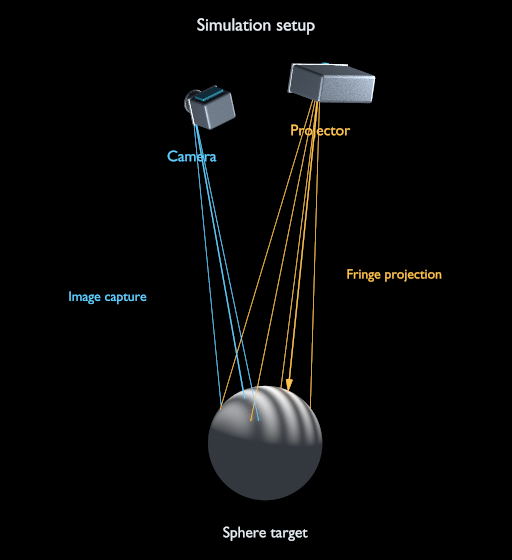
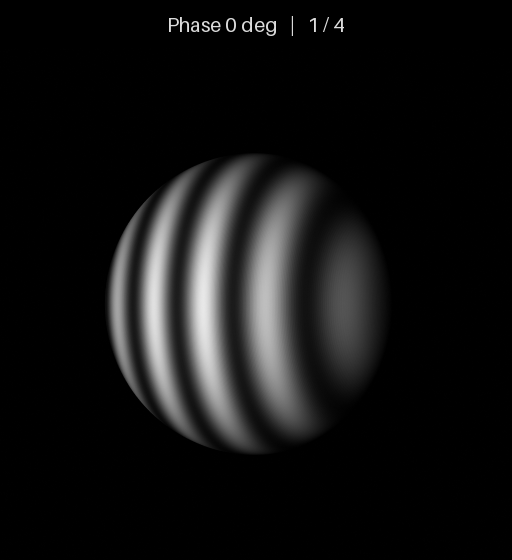

# DMD Structured-Light Simulator

[简体中文](README.md) | **English**

A Blender/Cycles structured-light simulator with one camera and one projector,
supporting **orthogonal DMD** and **Diamond-DMD (DLP4500)** layouts.

## Simulation setup and four-step phase shifting

| Simulation setup | Four-step camera images |
|:---:|:---:|
|  |  |

The left illustration uses the example's device poses and models. Gold lines show
projection and blue lines show camera imaging; supplementary lighting and
representative rays aid visibility. The animation on the right is rendered by the
orthogonal DMD example: a sphere of radius 0.1 m,
with a fringe period of 48 logical pixels and phases of 0°, 90°, 180° and 270°.
Each frame is 512×512; the GIF preserves the rendered grayscale values.
Both DMD examples use the same sphere and four-step phase-shift settings.

## Installation and quick start

Validated on Linux with Python 3.10 and Blender 4.5.3. Install Blender, then run:

```bash
git clone https://github.com/dspangpang/dmd-structured-light-sim.git
cd dmd-structured-light-sim
python3 -m venv .venv
source .venv/bin/activate
python -m pip install -r requirements.txt
export BLENDER_BIN=/path/to/blender

# Orthogonal DMD
python scripts/run_simulation.py --config examples/orthogonal/scene.json --output output/orthogonal

# Diamond-DMD
python scripts/run_simulation.py --config examples/diamond/scene.json --output output/diamond
```

The examples load the bundled models, generate fringes and render on the CPU.
Choose a new output directory for each run.

## Configuration and models

Copy either example's `scene.json` to change device poses, focal lengths,
resolutions, patterns, targets and materials. `patterns.period_px` sets the fringe
period; `phase_steps` sets the number of phase shifts. Custom grayscale images
follow the explicit order in `patterns.files`. Positions are in metres, focal
lengths in millimetres, pixel pitches in micrometres, and sizes in `[width, height]`.

| DMD type | Logical input | Simulation texture |
|---|---|---|
| `orthogonal` | Configurable width and height | Same as the input |
| `diamond` | DLP4500: 912×1140 | Per-pixel mapping to a 1481×1482 carrier with a matching projector rotation |

The Diamond carrier size is not the hardware upload size. Exported projector
intrinsics refer to carrier coordinates; conversions are recorded in the run's
`inputs/dmd_mapping.json`. The model describes geometric projection and texture imaging.

`assets/models/` contains three OBJ models with dimensions in metres:

- `camera.obj` and `projector.obj`: lightweight schematic housings loaded through
  `visualization`; optical parameters are determined by the configuration.
- `sphere.obj`: a sphere of radius 0.1 m, centred at the origin, loaded through `target.asset`.

These original example models are generated by the project. Run
`scripts/generate_assets.py` in Blender to rebuild them. Keep material files beside
their OBJ files. All installation and testing dependencies use one `requirements.txt`.

## Outputs and validation

`inputs/` stores configuration, fringes and mappings. Render subdirectories contain
camera images, floating-point EXR, depth, PLY point clouds, `calibration.json` and
run manifests.

`calibration.json` exports **calibration ground truth** directly from the scene:
camera and projector intrinsics `K`, extrinsics `world_to_device`, projection
matrices `P`, and relative device transforms `device_transforms`. It uses OpenCV
pixel-centre coordinates, translations in metres and zero distortion for the ideal
model. The repository provides ground-truth export only, with no calibration-board
generation, calibration-image capture or parameter-estimation workflow.

`COMPLETE` in `run.json` means rendering finished. `--prepare-only`
prepares inputs; `--validate-only` builds and checks the scene without capturing.
Point clouds are generated from ground-truth depth.

```bash
# Unit tests and actual renders for both DMD layouts
python -m unittest discover -s tests -v
python scripts/validate_examples.py --output output/validation

# Package four rendered phase frames as a GIF; the output must not exist
python scripts/make_preview.py --run output/orthogonal --output output/sphere.gif

# Render the setup illustration from the same example; the output must not exist
"$BLENDER_BIN" -b --factory-startup --python-exit-code 1 --python blender/render_setup_overview.py -- --render-request output/orthogonal/inputs/render_request.json --output output/setup.png
```

## License

Project code and bundled example models are licensed under **GPL-3.0-or-later**.
Copyright © 2026 Jia Zhizhou and contributors.
See [THIRD_PARTY_NOTICES.md](THIRD_PARTY_NOTICES.md) for third-party attribution
and [LICENSE](LICENSE) for the complete license.
