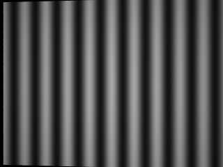
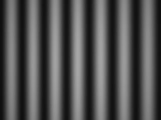

# DMD Structured-Light Simulator

[简体中文](README.md) | **English**

A Blender/Cycles simulator with one camera and one projector, supporting
**orthogonal DMD** and **Diamond-DMD (DLP4500)** layouts. Configure devices,
patterns, targets and materials through JSON, then export camera images,
floating-point images, depth, point clouds and calibration parameters.

## Installation and quick start

Validated on Linux with Python 3.10 and Blender 4.5.3. Install Blender separately,
then install Python dependencies from the repository's single requirements file:

```bash
git clone https://github.com/dspangpang/dmd-structured-light-sim.git
cd dmd-structured-light-sim
python3 -m venv .venv
source .venv/bin/activate
python -m pip install -r requirements.txt
export BLENDER_BIN=/path/to/blender

# Orthogonal DMD
python scripts/run_simulation.py --config examples/orthogonal/scene.json --output output/orthogonal

# Diamond-DMD
python scripts/run_simulation.py --config examples/diamond/scene.json --output output/diamond
```

Both examples generate a plane target and four sinusoidal phase-shift patterns,
render on the CPU, and produce 320×240 camera images. Choose a new output
directory for each run; existing directories are never overwritten.

| Orthogonal DMD example | Diamond-DMD example |
|---|---|
|  |  |

## Supported DMD layouts

| Type | Logical resolution in the configuration | Projector texture used for simulation |
|---|---|---|
| `orthogonal` | Configurable width and height | Same as the logical image |
| `diamond` | DLP4500: 912×1140 | Per-pixel mapping to a 1481×1482 carrier with a matching projector rotation |

The Diamond carrier size describes the simulation texture, not the image size
uploaded to hardware. Coordinate mappings are saved in `inputs/dmd_mapping.json`;
exported projector intrinsics refer to carrier coordinates. The model uses
geometric projection and texture imaging. It does not simulate micromirror timing,
diffraction or a measured optical PSF.

## Configuration

Copy either example's `scene.json` and adjust:

- `camera` and `projector`: position, orientation, resolution, focal length and pixel pitch.
- `patterns`: generated sinusoids or an explicitly ordered list of grayscale image files.
- `target`: a plane, box, cylinder or custom model, and its material.
- `render` and `capture`: sample count, CPU/GPU selection, projector energy and output types.

Dimensions use `[width, height]`; positions are in metres, focal lengths in
millimetres, and pixel pitches in micrometres. Append `--prepare-only` to prepare
inputs without starting Blender, or `--validate-only` to build and validate the
scene in Blender without capturing images. See the [configuration reference](docs/configuration.md)
for all options.

## Outputs and repository layout

Each run writes to the specified output directory:

- `inputs/`: configuration snapshots, patterns, coordinate mappings and the render request.
- Render subdirectory: camera images, optional floating-point EXR images, depth and
  world-space PLY point clouds, plus `calibration.json`, `params.txt` and `render_manifest.json`.
- `run.json`: run status; `COMPLETE` means rendering finished, while `VALIDATED` means
  scene validation finished.

The main repository directories are:

```text
examples/     Independent configurations for both DMD layouts
scripts/      Run, validation and postprocessing entry points
src/          Configuration, coordinates, projection and rendering
blender/      Blender scene execution entry points
tests/        Automated checks
docs/         Configuration, coordinates and validation documentation
3rdparty/     Projector add-on
```

## Validation

After installing `requirements.txt`, run:

```bash
python -m unittest discover -s tests -v
python scripts/validate_examples.py --output output/validation
"$BLENDER_BIN" -b --factory-startup -t 2 --python-exit-code 1 --python tests/blender_pixel_coordinates.py
```

The example checks cover phase-shift images, auxiliary outputs, calibration files,
completion manifests and point-cloud geometry. Point clouds are generated from
ground-truth depth; these checks establish functionality and coordinate consistency.
See the [validation report](docs/validation.md), [DMD coordinates](docs/dmd_coordinates.md),
[pixel and calibration coordinates](docs/pixel_coordinates.md), and
[calibration-board and postprocessing interfaces](docs/advanced.md).

## License

Project code is licensed under **GPL-3.0-or-later**.
Copyright © 2026 Jia Zhizhou and contributors. Third-party code retains its original
author and license notices. See [LICENSE](LICENSE) and
[THIRD_PARTY_NOTICES.md](THIRD_PARTY_NOTICES.md).
