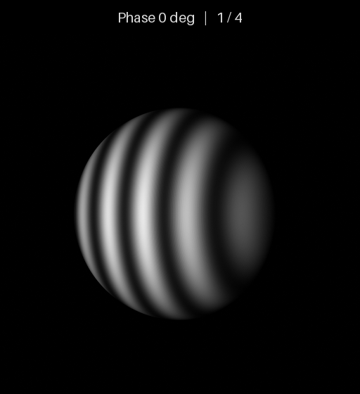

# DMD 结构光仿真环境

**简体中文** | [English](README.en.md)

基于 Blender/Cycles 的单相机、单投影仪结构光仿真，支持**正交 DMD**和
**Diamond-DMD（DLP4500）**。

## 球面四步相移示例



上图由正交 DMD 示例实际渲染：半径 0.1 米的球体，条纹周期 48 个逻辑像素，
依次显示 0°、90°、180°、270° 四个相位。每帧为 512×512，动图保持渲染灰度值。
两种 DMD 示例使用相同的球体和四步相移设置。

## 安装与运行

已验证环境：Linux、Python 3.10、Blender 4.5.3。先安装 Blender，再执行：

```bash
git clone https://github.com/dspangpang/dmd-structured-light-sim.git
cd dmd-structured-light-sim
python3 -m venv .venv
source .venv/bin/activate
python -m pip install -r requirements.txt
export BLENDER_BIN=/path/to/blender

# 正交 DMD
python scripts/run_simulation.py --config examples/orthogonal/scene.json --output output/orthogonal

# Diamond-DMD
python scripts/run_simulation.py --config examples/diamond/scene.json --output output/diamond
```

示例直接加载仓库自带模型并生成条纹，默认使用 CPU。每次运行请指定新输出目录。

## 配置与模型

复制一个示例的 `scene.json` 即可修改设备位置、朝向、焦距、分辨率、图案、目标和材质。
`patterns.period_px` 控制周期，`phase_steps` 控制相移步数；自定义灰度图按 `patterns.files`
的显式列表顺序输入。位置单位为米，焦距为毫米，像元尺寸为微米，分辨率为 `[宽, 高]`。

| DMD 类型 | 逻辑输入 | 仿真纹理 |
|---|---|---|
| `orthogonal` | 宽、高可配置 | 与输入相同 |
| `diamond` | DLP4500：912×1140 | 逐像素映射到 1481×1482 载体，并匹配投影仪旋转 |

Diamond 的载体尺寸不是硬件上传尺寸，导出的投影仪内参对应载体坐标，坐标换算见
运行结果中的 `inputs/dmd_mapping.json`。当前模型描述几何投影与纹理成像。

`assets/models/` 提供三个以米为单位的 OBJ 模型：

- `camera.obj`、`projector.obj`：轻量设备外壳示意，由 `visualization` 配置加载；光学参数由配置决定。
- `sphere.obj`：半径 0.1 米、中心在原点的球体，由 `target.asset` 加载。

模型是本项目生成的原创示例，可通过 Blender 执行 `scripts/generate_assets.py` 重新生成。
材质文件与对应 OBJ 放在同一目录。所有安装与测试依赖都在唯一的 `requirements.txt` 中。

## 输出与验证

`inputs/` 保存配置、条纹和映射；渲染子目录保存相机图像、浮点 EXR、深度、PLY 点云、
`calibration.json` 和运行清单。标定采用 OpenCV 像素中心坐标，平移单位为米。
`run.json` 中的 `COMPLETE` 表示渲染完成；`--prepare-only` 仅准备输入，
`--validate-only` 仅建立场景并校验几何。点云由深度真值生成。

```bash
# 单元测试与两种 DMD 的实际渲染检查
python -m unittest discover -s tests -v
python scripts/validate_examples.py --output output/validation

# 用已渲染的四张相移图生成动图，输出文件须不存在
python scripts/make_preview.py --run output/orthogonal --output output/sphere.gif
```

## 许可证

项目代码和自带示例模型采用 **GPL-3.0-or-later**。
Copyright © 2026 Jia Zhizhou and contributors。
第三方声明见 [THIRD_PARTY_NOTICES.md](THIRD_PARTY_NOTICES.md)，完整许可证见 [LICENSE](LICENSE)。
